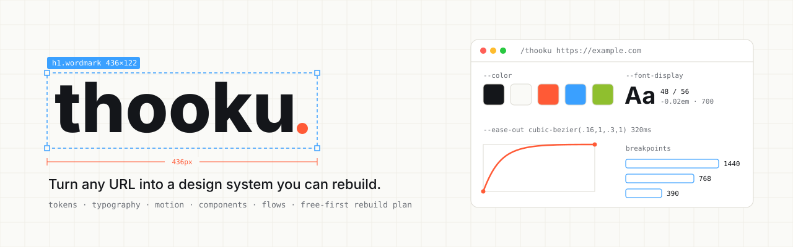

<p align="center">
  <picture>
    <source media="(prefers-color-scheme: dark)" srcset="assets/banner-dark.svg" />
    
  </picture>
</p>

<p align="center">
  <a href="https://github.com/niranjraj/thooku/releases/latest"></a>
  &nbsp;
  <a href="https://github.com/niranjraj/thooku/actions/workflows/check-skill.yml"></a>
  &nbsp;
  <a href="LICENSE"></a>
  &nbsp;
  <a href="https://github.com/niranjraj/thooku/stargazers"></a>
  &nbsp;
  <a href="CHANGELOG.md"></a>
</p>

<p align="center">
  <a href="https://agentskills.io"></a>
  &nbsp;
  <a href="https://docs.claude.com/en/docs/claude-code/plugins"></a>
  &nbsp;
  
  &nbsp;
  <a href="https://buymeacoffee.com/niranjraj"></a>
</p>

**thooku** is an Agent Skill that turns a coding agent into a website design investigator. Give it one URL, or ten, and it opens the pages, measures them, and hands back the site's design system: tokens, type scale, components, every hover and transition, responsive breakpoints, user flows, and a plan to rebuild it with free tools.

It works from evidence, not screenshots alone. Every value in the report is labeled `Observed`, `Measured`, `Inferred`, or `Unknown`, so you know which numbers to trust.

## Install

```bash
npx skills add niranjraj/thooku
```

That installs the skill with the [`npx skills`](https://github.com/vercel-labs/skills) CLI, which works with Claude Code, Codex, Cursor, and other agents that read the open Agent Skills format.

<details>
<summary>Claude Code plugin</summary>

Run these inside Claude Code:

```
/plugin marketplace add niranjraj/thooku
/plugin install thooku@thooku
```

On Claude Code 2.1.275 or later, one line does both:

```
/plugin install thooku --marketplace niranjraj/thooku
```

`/plugin update` upgrades it later.

</details>

<details>
<summary>Manual install from a clone</summary>

```bash
git clone https://github.com/niranjraj/thooku.git
mkdir -p ~/.claude/skills
cp -r thooku/skills/thooku ~/.claude/skills/thooku
```

For a single project, copy into `.claude/skills/thooku` inside that project instead. On Windows, the global folder is `%USERPROFILE%\.claude\skills\thooku\`.

</details>

<details>
<summary>claude.ai</summary>

Download `thooku.zip` from the [latest release](https://github.com/niranjraj/thooku/releases/latest) and upload it under **Settings > Capabilities > Skills**. Availability depends on your plan and workspace settings.

</details>

## Usage

```text
/thooku https://example.com
```

With one URL and no other instructions, thooku runs a standard audit of the landing page plus up to three internal pages linked from the main navigation, at desktop (1440×900), tablet (768×1024), and mobile (390×844).

More things to ask:

- `/thooku https://example.com` audit the landing page and give me a React reconstruction spec.
- Inspect this product page's animation and typography at desktop and mobile.
- Compare these two sites and extract a shared design system.
- Analyze these eight websites, compare their typography and motion, and synthesize a coherent design system using free dependencies.
- Rebuild the visual structure in my existing Vite + React project using free dependencies only.
- Map the sign-up flow without submitting the form.

## What you get

A single report, in this order:

| # | Section | What it holds |
| --- | --- | --- |
| 1 | Executive summary | Visual identity, interaction character, major templates, overall confidence |
| 2 | Inspection coverage | URLs, viewports, tools, date, access gaps |
| 3 | Page anatomy | Section-by-section structure and layout |
| 4 | Design tokens | Table plus copy-ready CSS variables |
| 5 | Typography | Font evidence, hierarchy, sizes, line heights, fallbacks |
| 6 | Components and states | Variants, hover/focus/active/disabled, responsive rules, accessibility |
| 7 | Motion and transitions | Trigger, properties, duration, easing, reduced-motion notes |
| 8 | Responsive behavior | Desktop, tablet, and mobile differences, breakpoints |
| 9 | User flows | Key journeys and branching states |
| 10 | Asset inventory | Sources, formats, purpose, license confidence |
| 11 | Free alternative map | Paid item, free replacement, trade-offs |
| 12 | Implementation blueprint | File and component plan, order of work, risks |
| 13 | Evidence and uncertainty | Observed vs inferred vs not inspected |

Tokens come out ready to paste. An illustrative excerpt:

```css
:root {
  --color-ink: #14161a;        /* Measured: body color */
  --color-accent: #ff5a36;     /* Measured: primary button background */
  --font-display: "Inter", system-ui, sans-serif; /* Observed: @font-face */
  --text-display: 3rem;        /* Measured: h1 at 1440px */
  --leading-display: 1.167;    /* Measured: 56px / 48px */
  --ease-out: cubic-bezier(.16, 1, .3, 1); /* Observed: .btn transition */
  --duration-base: 320ms;      /* Observed: .btn transition */
}
```

## How it works

1. **Scope and access.** Normalizes the URL, checks redirects and login walls, reads `robots.txt`, stays on the same origin.
2. **Structure and visuals.** Screenshots and DOM, computed styles for representative elements, CSS custom properties, fonts, and assets, repeated at three viewports.
3. **Interactions and motion.** Hovers, focus, menus, dialogs, accordions, scroll effects. Records trigger, start and end state, properties, duration, and easing for each.
4. **Design system.** Groups repeated values into semantic tokens and keeps measured values apart from inferred ones.
5. **Components and flows.** Inventories components with variants and states, and maps journeys without submitting anything irreversible.
6. **Assets and dependencies.** Lists fonts, icons, images, and services, and finds a free or open-source alternative for every paid one.
7. **Reconstruction.** If asked, builds it in your project with your conventions, accessible focus states, and `prefers-reduced-motion` support.

### Multiple websites

Pass several URLs and thooku switches to comparison mode. It builds a site registry, inspects the same viewports and checklist on each site, writes a per-site profile, and then a cross-site matrix. If you ask for a unified system, it sorts patterns into shared, selected (with the reason), and conflicting, and records which source each design decision came from. It samples representative pages instead of crawling everything, and says exactly which pages it inspected.

## Requirements

- **No API keys and no paid services.** The skill is plain instructions.
- **For live inspection** (menus, animation, responsive behavior), the agent needs a browser. The free, recommended route is the [Playwright CLI](https://www.npmjs.com/package/@playwright/cli):

  ```bash
  npm install -g @playwright/cli@latest
  ```

  Setup options, including Python and static-only, are in [`skills/thooku/references/tooling.md`](skills/thooku/references/tooling.md).
- **Without a browser,** thooku falls back to static HTML and CSS analysis and marks dynamic behavior as unverified.

## Common questions

**Does it copy websites?**  
No. It documents design patterns and rebuilds them with original or openly licensed assets. It does not copy logos, copy text, proprietary images, or source code, and it marks unclear licenses as `verify license`.

**Will it log in, get past CAPTCHAs, or submit forms?**  
No. It inspects only pages you can access, does not bypass paywalls, logins, or bot protection, and never submits purchases, messages, or other irreversible actions.

**Does it work with React, Vue, Svelte, plain HTML?**  
Yes. Reports are framework-neutral. For implementation, it follows the stack your project already uses.

**How accurate are the numbers?**  
As accurate as the evidence. Values read from computed styles or source CSS are labeled `Measured` or `Observed`. Anything estimated from a screenshot is labeled `Inferred`, and anything it could not check is `Unknown`.

## Support the project

If thooku saves you time, consider buying me a coffee:

<a href="https://buymeacoffee.com/niranjraj"></a>

Starring the repo also helps other people find it.

<p align="center">
  <a href="https://www.star-history.com/#niranjraj/thooku&Date">
    <picture>
      <source media="(prefers-color-scheme: dark)" srcset="https://api.star-history.com/svg?repos=niranjraj/thooku&type=Date&theme=dark" />
      
    </picture>
  </a>
</p>

## Contributing

Issues and pull requests are welcome. Before opening a pull request, run the same check CI runs:

```bash
npm install --no-save --no-package-lock yaml@2.6.1
node tests/frontmatter.mjs
```

## Repository layout

```text
skills/thooku/SKILL.md               the skill: workflow and output contract
skills/thooku/references/tooling.md  free-first browser tooling setup
.claude-plugin/marketplace.json      Claude Code plugin marketplace manifest
tests/frontmatter.mjs                frontmatter and reference checks
assets/                              README banners
```

## License

[MIT License](LICENSE) · Copyright (c) 2026 Niranj Raj
